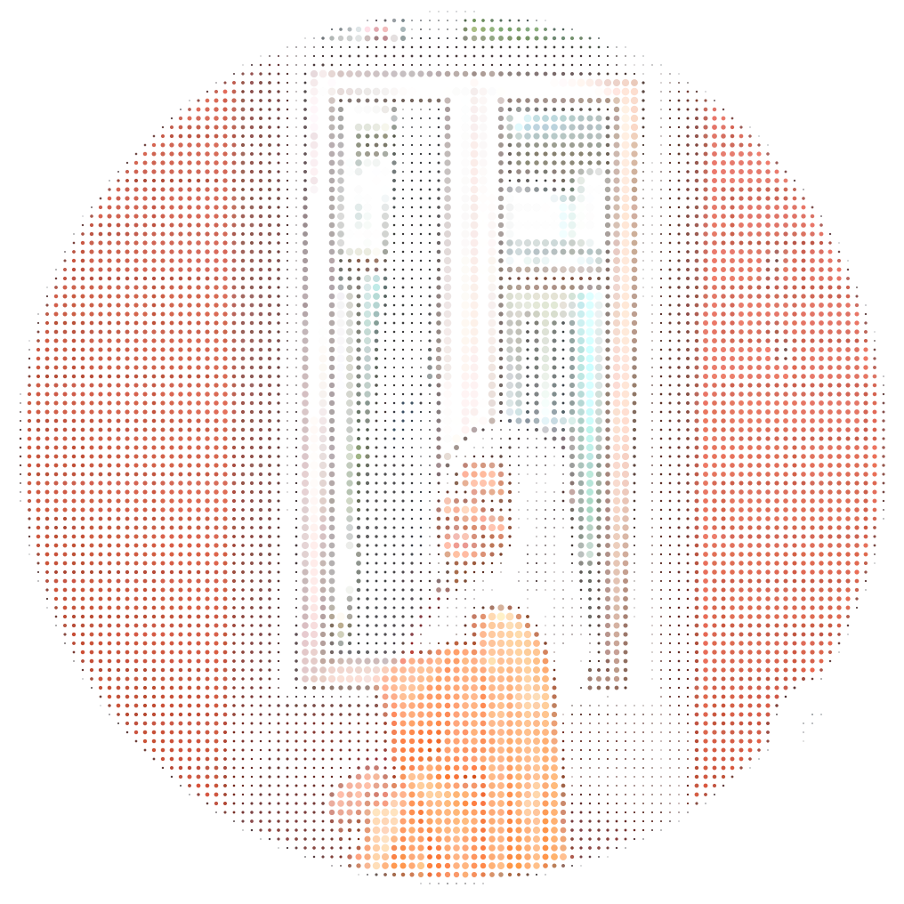
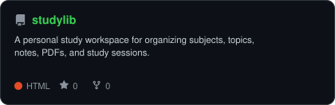
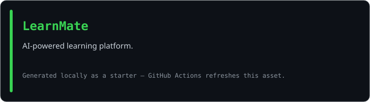
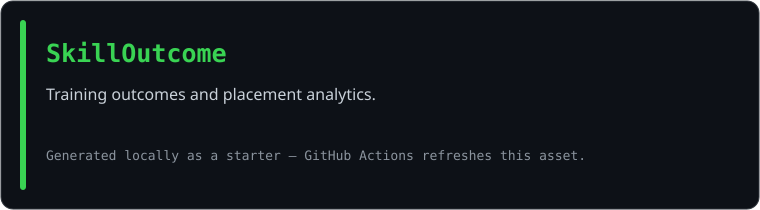
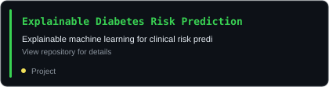

<div align="center">

<!-- Portrait generated from your profile photo by scripts/dotify.py. -->


<br>

<a href="https://github.com/jagrati-s12">
  
</a>

<br>

<a href="https://www.linkedin.com/in/jagrati-sharma-6a2b5a2ab/"></a>
<a href="mailto:sjagrati822@gmail.com"></a>
<a href="https://github.com/jagrati-s12"></a>
<a href="https://leetcode.com/u/jag_281/"></a>


</div>

---

## `~/` whoami

```console
$ cat about.txt
```

Hi, I'm **Jagrati Sharma**, a Computer Science Engineering student at **KIIT University (2024–2028)**. I enjoy building useful software, solving problems, and exploring how machine learning can help with real-world challenges.

- Studying **Computer Science Engineering at KIIT University (2024–2028)**
- GPA: **9.35 / 10**
- Interested in **Software Development, DSA, AI/ML, and Web Development**
- Exploring **Explainable AI** and healthcare-focused machine learning
- Hackathon participant: **Ignithon 2025**
- Currently building projects across full-stack development and machine learning

<br>

<div align="center">

## `~/` toolbox


</div>

---

<div align="center">

## `~/` skill radar

<table>
<tr>
<td width="50%" align="center" valign="middle">

<picture>
  <source media="(prefers-color-scheme: dark)" srcset="assets/radar-dark.svg">
  <source media="(prefers-color-scheme: light)" srcset="assets/radar-light.svg">
  
</picture>

</td>
<td width="50%" align="center" valign="middle">

<picture>
  <source media="(prefers-color-scheme: dark)" srcset="assets/radar-langs-dark.svg">
  <source media="(prefers-color-scheme: light)" srcset="assets/radar-langs-light.svg">
  
</picture>

</td>
</tr>
</table>

</div>

---

<div align="center">


<div align="center">

## `~/` contribution calendar


</div>

## `~/` the numbers

<picture>
  <source media="(prefers-color-scheme: dark)" srcset="assets/card-stats-dark.svg">
  <source media="(prefers-color-scheme: light)" srcset="assets/card-stats-light.svg">
  
</picture>

<br>


<br><br><br>


<br><br>


</div>

---

<div align="center">

## `~/` selected work

<table>
<tr>
<td width="50%">
  <a href="https://github.com/jagrati-s12/StudyLib">
    <picture><source media="(prefers-color-scheme: dark)" srcset="assets/card-StudyLib-dark.svg"><source media="(prefers-color-scheme: light)" srcset="assets/card-StudyLib-light.svg"></picture>
  </a>
</td>
<td width="50%">
  <a href="https://github.com/jagrati-s12/LearnMate">
    <picture><source media="(prefers-color-scheme: dark)" srcset="assets/card-learnmate-dark.svg"><source media="(prefers-color-scheme: light)" srcset="assets/card-learnmate-light.svg"></picture>
  </a>
</td>
</tr>
<tr>
<td width="50%">
  <a href="https://github.com/jagrati-s12/skilloutcome">
    <picture><source media="(prefers-color-scheme: dark)" srcset="assets/card-skilloutcome-dark.svg"><source media="(prefers-color-scheme: light)" srcset="assets/card-skilloutcome-light.svg"></picture>
  </a>
</td>
<td width="50%">
  <a href="https://github.com/jagrati-s12/Explainable-Diabetes-Risk-Prediction">
    <picture><source media="(prefers-color-scheme: dark)" srcset="assets/card-Explainable-Diabetes-Risk-Prediction-dark.svg"><source media="(prefers-color-scheme: light)" srcset="assets/card-Explainable-Diabetes-Risk-Prediction-light.svg"></picture>
  </a>
</td>
</tr>
</table>

<sub>

| project | description | stack |
|---|---|---|
| **[StudyLib](https://github.com/jagrati-s12/StudyLib)** | Personal study workspace for notes and documents | `React` `Python` |
| **[LearnMate](https://github.com/jagrati-s12/LearnMate)** | AI-assisted learning platform | `React` `JavaScript` `AI` |
| **[SkillOutcome](https://github.com/jagrati-s12/skilloutcome)** | Skills and training outcomes project | `Web Development` |
| **[Explainable Diabetes Risk Prediction](https://github.com/jagrati-s12/Explainable-Diabetes-Risk-Prediction)** | Explainable machine learning for clinical risk prediction | `Python` `XGBoost` `SHAP` |

</sub>

</div>

---

<div align="center">

<a href="https://leetcode.com/u/jag_281/">LeetCode profile: jag_281</a>

<br><br>

<a href="https://leetcode.com/u/jag_281/">
  
</a>

<br>

<sub>`01100010 01110101 01101001 01101100 01100100 00100000 01101100 01100101 01100001 01110010 01101110 00100000 01110010 01100101 01110000 01100101 01100001 01110100`</sub>

</div>
