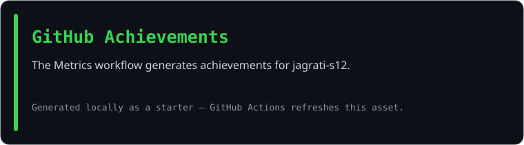

<div align="center">

<!-- Terminal-inspired monogram; replace assets/portrait.svg with your own dot-matrix portrait if desired. -->


<br>

<a href="https://github.com/jagrati-s12">
  
</a>

<br>

<a href="https://www.linkedin.com/in/jagrati-sharma-6a2b5a2ab/"></a>
<a href="mailto:sjagrati822@gmail.com"></a>
<a href="https://github.com/jagrati-s12"></a>
<a href="https://leetcode.com/u/jag_281/"></a>


</div>

---

## `~/` whoami

```console
$ cat about.txt
```

Hi, I'm **Jagrati Sharma**, a Computer Science Engineering student at **KIIT University (2024–2028)**. I enjoy building useful software, solving problems, and exploring how AI can make applications more helpful.

- Studying **B.Tech in Computer Science Engineering at KIIT (2024–2028)**
- Current GPA: **9.35 / 10**
- Building with **Java, Python, JavaScript, React, and web technologies**
- Exploring **AI/ML and Explainable AI**, including healthcare applications
- Practicing **Data Structures & Algorithms** and software engineering
- Hackathon participant: **Ignithon 2025**
- Learning by building projects and turning ideas into working software

<br>

<div align="center">

## `~/` toolbox


</div>

---

<div align="center">

## `~/` skill radar

<table>
<tr>
<td width="50%" align="center" valign="middle">

<!-- Editable self-ratings: change assets/skills.json and run the Charts and cards workflow. -->
<picture>
  <source media="(prefers-color-scheme: dark)" srcset="assets/radar-dark.svg">
  <source media="(prefers-color-scheme: light)" srcset="assets/radar-light.svg">
  
</picture>

</td>
<td width="50%" align="center" valign="middle">

<!-- Live language mix is generated from the repositories on this GitHub account. -->
<picture>
  <source media="(prefers-color-scheme: dark)" srcset="assets/radar-langs-dark.svg">
  <source media="(prefers-color-scheme: light)" srcset="assets/radar-langs-light.svg">
  
</picture>

</td>
</tr>
</table>

</div>

---

<div align="center">

## `~/` contribution calendar

<!-- Generated by the Metrics workflow after you push this repo and add METRICS_TOKEN. -->


<br><br>

<!-- Snake workflow generates these files on the output branch. -->
<picture>
  <source media="(prefers-color-scheme: dark)" srcset="https://raw.githubusercontent.com/jagrati-s12/jagrati-s12/output/snake-dark.svg">
  <source media="(prefers-color-scheme: light)" srcset="https://raw.githubusercontent.com/jagrati-s12/jagrati-s12/output/snake.svg">
  
</picture>

</div>

---

<div align="center">

## `~/` the numbers

<!-- These assets are placeholders until the Metrics workflow runs for your account. -->
<picture>
  <source media="(prefers-color-scheme: dark)" srcset="assets/card-stats-dark.svg">
  <source media="(prefers-color-scheme: light)" srcset="assets/card-stats-light.svg">
  
</picture>

<br>


<br><br>



</div>

---

<div align="center">

## `~/` selected work

<!-- Cards are refreshed from assets/projects.json by scripts/cards.py. -->
<table>
<tr>
<td width="50%">
  <a href="https://github.com/jagrati-s12/StudyLib">
    <picture><source media="(prefers-color-scheme: dark)" srcset="assets/card-StudyLib-dark.svg"><source media="(prefers-color-scheme: light)" srcset="assets/card-StudyLib-light.svg"></picture>
  </a>
</td>
<td width="50%">
  <a href="https://github.com/jagrati-s12/learnmate">
    <picture><source media="(prefers-color-scheme: dark)" srcset="assets/card-learnmate-dark.svg"><source media="(prefers-color-scheme: light)" srcset="assets/card-learnmate-light.svg"></picture>
  </a>
</td>
</tr>
<tr>
<td width="50%">
  <a href="https://github.com/jagrati-s12/skilloutcome">
    <picture><source media="(prefers-color-scheme: dark)" srcset="assets/card-skilloutcome-dark.svg"><source media="(prefers-color-scheme: light)" srcset="assets/card-skilloutcome-light.svg"></picture>
  </a>
</td>
<td width="50%">
  <a href="https://github.com/jagrati-s12/Explainable-Diabetes-Risk-Prediction">
    <picture><source media="(prefers-color-scheme: dark)" srcset="assets/card-Explainable-Diabetes-Risk-Prediction-dark.svg"><source media="(prefers-color-scheme: light)" srcset="assets/card-Explainable-Diabetes-Risk-Prediction-light.svg"></picture>
  </a>
</td>
</tr>
</table>

<sub>

| project | description | stack |
|---|---|---|
| **[StudyLib](https://github.com/jagrati-s12/StudyLib)** | Personal study workspace for notes and documents | `React` `Python` |
| **[LearnMate](https://github.com/jagrati-s12/learnmate)** | AI-powered learning platform | `React` `AI` |
| **[SkillOutcome](https://github.com/jagrati-s12/skilloutcome)** | Training outcomes and placements dashboard | `React` `FastAPI` |
| **[Diabetes Risk Prediction](https://github.com/jagrati-s12/Explainable-Diabetes-Risk-Prediction)** | Explainable ML for diabetes risk prediction | `Python` `XGBoost` `SHAP` |

</sub>

</div>

---

<div align="center">

<sub>`01110100 01101000 01100001 01101110 01101011 01110011 00100000 01100110 01101111 01110010 00100000 01110011 01100011 01110010 01101111 01101100 01101100 01101001 01101110 01100111`</sub>

</div>
